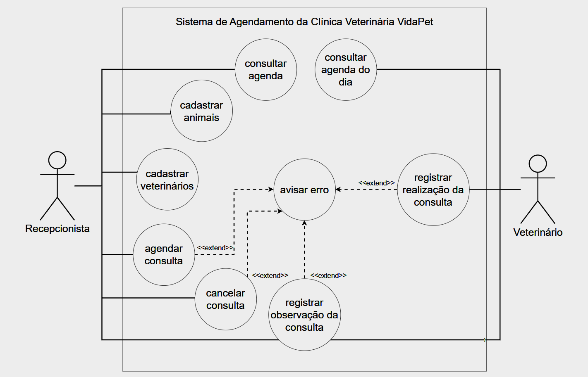

# Modelagem do Sistema de Agendamento da Clínica Veterinária VidaPet

## Sistema de Agendamento da Clínica Veterinária VidaPet

A VidaPet é uma clínica veterinária pequena que atende cães e gatos. Hoje a agenda fica num caderno na recepção, o que causa horários marcados em duplicidade e consultas esquecidas. O sistema deve organizar o cadastro dos animais e a agenda de consultas dos veterinários.

### Entidades principais

- **Animal**: nome, espécie (cão ou gato), idade, nome do tutor e telefone do tutor.
- **Veterinário**: nome e CRMV.
- **Consulta**: animal, veterinário, data, horário, situação (agendada, realizada ou cancelada) e observações.

### Atores

- **Recepcionista**: cadastra animais e veterinários, agenda e cancela consultas.
- **Veterinário**: consulta sua agenda do dia e registra a consulta como realizada, com as observações do atendimento.

### Regras de negócio

1. As consultas duram 30 minutos e só podem ser marcadas de segunda a sexta, das 8h às 18h.
2. Um veterinário não pode ter duas consultas agendadas no mesmo horário.
3. Não é possível agendar consultas em datas que já passaram.
4. Uma consulta só pode ser cancelada se ainda estiver como agendada.
5. Somente consultas agendadas podem ser marcadas como realizadas, e apenas pelo veterinário da consulta.

## Documento de Requisitos

### Requisitos Funcionais

- **RF01**: Cadastrar animais.
- **RF02**: Cadastrar veterinários.
- **RF03**: Agendar consulta.
- **RF04**: Cancelar consulta.
- **RF05**: Consultar agenda.
- **RF06**: Registrar realização da consulta.
- **RF07**: Registrar observação da consulta.
- **RF08**: Avisar erro.

### Requisitos Não Funcionais

- **RNF01**: A espécie do animal deve ser cão ou gato.
- **RNF02**: Apenas o recepcionista cadastra animais.
- **RNF03**: Apenas o recepcionista cadastra veterinários.
- **RNF04**: A situação da consulta deve ser agendada, realizada ou cancelada.
- **RNF05**: Apenas o recepcionista agenda consultas.
- **RNF06**: As consultas podem apenas ser agendadas de segunda a sexta, das 8h às 17h30, a partir de agora.
- **RNF07**: Uma consulta não pode ser agendada com uma distância menor que 30m de outra.
- **RNF08**: Apenas o recepcionista cancela consultas.
- **RNF09**: Apenas consultas agendadas podem ser canceladas.
- **RNF10**: O veterinário pode apenas consultar a agenda do dia.
- **RNF11**: Apenas o veterinario consultado registra a realização da consulta.
- **RNF12**: Apenas consultas agendadas podem ser realizadas.
- **RNF13**: A realização e observação da consulta são interdependentes.

## Diagrama de Casos de Uso

